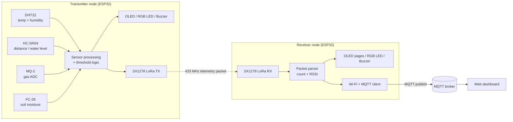

# LoRa-Based Flood Monitoring and Alert System

> Dual-ESP32 IoT prototype for long-range environmental sensing, wireless telemetry over 433 MHz LoRa, and local visual/audible flood alerts.


---

## Table of Contents

1. [Overview](#1-overview)
2. [Problem Statement](#2-problem-statement)
3. [Objectives](#3-objectives)
4. [System Architecture](#4-system-architecture)
5. [Hardware Components](#5-hardware-components)
6. [Wiring Reference](#6-wiring-reference)
7. [Firmware Workflow](#7-firmware-workflow)
8. [Telemetry Packet Format](#8-telemetry-packet-format)
9. [Alert Thresholds](#9-alert-thresholds)
10. [Software and Libraries](#10-software-and-libraries)
11. [Setup and Build Instructions](#11-setup-and-build-instructions)
12. [Testing and Validation](#12-testing-and-validation)
13. [Project Status and Roadmap](#13-project-status-and-roadmap)
14. [MQTT Web Dashboard](#14-mqtt-web-dashboard)
15. [Limitations and Safety](#15-limitations-and-safety)
16. [Repository Structure](#16-repository-structure)
17. [Author](#17-author)

---

## 1. Overview

This project is an IoT prototype for collecting environmental measurements at a remote sensing node and transmitting them to a separate monitoring unit.

- A **transmitter ESP32** reads temperature, humidity, ultrasonic distance, gas-sensor analog output and soil moisture. Firmware derives a soil-moisture percentage, evaluates configurable thresholds, and sends a compact telemetry packet over a 433 MHz LoRa link.
- A **receiver ESP32** receives and parses the packet, shows readings and radio information (packet count, RSSI) on an OLED, and drives an RGB LED and buzzer according to the reported alert state.
- The sensor-to-receiver link **does not require Wi-Fi or internet access**.
- The receiver also connects to Wi-Fi and **publishes each parsed packet over MQTT**, so the readings appear live on a **web dashboard**.

| Area | Details |
|---|---|
| Domain | IoT, embedded systems, wireless communication |
| Controllers | 2 × ESP32 DevKit V1 (transmitter and receiver) |
| Radio | RA-02 / SX1278 LoRa modules, 433 MHz |
| Cloud / web | MQTT publishing from the receiver ESP32 to a web dashboard |
| Sensors | DHT22, HC-SR04, MQ-2, FC-28 soil moisture |
| Feedback | SSD1306 OLED displays, RGB LEDs, buzzers |

## 2. Problem Statement

Flood-prone locations often have limited internet coverage, and manual checks are slow or unsafe. This prototype explores a low-data-rate, long-range wireless sensing setup with local status indication, using inexpensive components.

> It is an educational prototype, **not** a certified public-safety warning instrument.

## 3. Objectives

- Acquire environmental data from multiple sensors on an ESP32.
- Estimate water level from an ultrasonic distance reading and a configured reference.
- Convert soil-moisture ADC readings into a calibrated 0–100% estimate.
- Classify measurements into **normal / warning / danger** using configurable thresholds.
- Transmit readings over 433 MHz LoRa.
- Display measurements, packet statistics and RSSI on an OLED.
- Provide visual and audible alerts at the receiver.
- Publish received telemetry over MQTT and show it live on a web dashboard.

## 4. System Architecture



| Stage | Operation | Output |
|---|---|---|
| Sensing | DHT22, HC-SR04, MQ-2, soil sensor | Raw and derived readings |
| Processing | Transmitter firmware | Sensor values and alert level |
| Wireless link | SX1278 LoRa, 433 MHz | Telemetry packet |
| Receiving | Receiver firmware | Parsed data, packet count, RSSI |
| Indication | OLED, RGB LED, buzzer | Local monitoring and alerts |
| Cloud | Receiver Wi-Fi + MQTT client | Live web dashboard |

## 5. Hardware Components

| Component | Purpose |
|---|---|
| 2 × ESP32 DevKit V1 | Transmitter and receiver microcontrollers |
| 2 × RA-02 / SX1278 LoRa modules | 433 MHz wireless link |
| DHT22 | Temperature and relative humidity |
| HC-SR04 | Ultrasonic distance for water-level estimation |
| MQ-2 module | Analog gas/smoke-related output |
| FC-28 soil-moisture module | Analog soil moisture |
| 2 × SSD1306 128×64 OLED | Local display (I²C, usually `0x3C`) |
| RGB LEDs + 220–330 Ω resistors | Visual status indication |
| Buzzer(s) | Audible alerts |
| Power supplies, jumpers, breadboards | Prototype assembly |

## 6. Wiring Reference

### 6.1 Transmitter

| Device / signal | ESP32 pin | Notes |
|---|---|---|
| OLED SDA / SCL | D21 / D22 | 3V3 power; common GND |
| DHT22 data | D4 | 3V3; pull-up if required |
| Soil AO / DO | D35 / D14 | Percentage logic uses AO |
| HC-SR04 TRIG / ECHO | D5 / D18 | Reduce ECHO voltage to 3.3 V |
| MQ-2 analog out | D34 | Voltage conditioning if output can exceed 3.3 V |
| Buzzer | D25 | Transistor driver if current requires it |
| RGB R / G / B | D26 / D27 / D32 | Resistor per channel; common-cathode GND |
| LoRa SCK / MISO / MOSI | D13 / D19 / D23 | SPI |
| LoRa NSS / RST / DIO0 | D33 / D15 / D12 | Custom radio control pins |

### 6.2 Receiver

| Device / signal | ESP32 pin | Notes |
|---|---|---|
| OLED SDA / SCL | D21 / D22 | I²C, usually `0x3C` |
| LoRa SCK / MISO / MOSI | D18 / D19 / D23 | SPI |
| LoRa NSS / RST / DIO0 | D5 / D14 / D26 | Must match receiver firmware |
| RGB R / G / B | D27 / D32 / D25 | Resistor per channel; common-cathode GND |
| Buzzer | D33 | Transistor driver if required |

> **Pin note:** on the transmitter, D12 and D15 are boot-strapping pins on common ESP32 boards. External circuits on them can cause boot problems. Reassign if needed and update the firmware.

## 7. Firmware Workflow

### 7.1 Transmitter

1. Initialize sensors, OLED, outputs, SPI and LoRa.
2. Read DHT22 temperature and humidity.
3. Measure ultrasonic distance and derive a water-level value from the configured reference geometry.
4. Read MQ-2 analog value and soil-moisture ADC value.
5. Map soil ADC between calibrated dry and wet endpoints to a percentage.
6. Evaluate warning/danger thresholds (danger takes priority).
7. Update OLED, RGB LED and buzzer.
8. Transmit telemetry over LoRa.

### 7.2 Receiver

1. Initialize OLED, LoRa radio, RGB LED and buzzer.
2. Listen for LoRa packets and parse the comma-separated payload.
3. Update packet count, last-packet time and RSSI.
4. Show sensor data and alert state across OLED pages.
5. Green = normal, yellow = warning, red = danger; drive the buzzer accordingly.
6. Flag stale/lost data if no packet arrives within the configured timeout.

## 8. Telemetry Packet Format

```
temperature,humidity,waterLevel,gasValue,soilPercent,warningLevel,distanceCm
```

| Field | Meaning |
|---|---|
| `temperature` | DHT22 temperature (°C) |
| `humidity` | Relative humidity (%) |
| `waterLevel` | Derived water-level value (depends on reference geometry and code formula) |
| `gasValue` | Raw MQ-2 ADC reading (not calibrated ppm) |
| `soilPercent` | Estimated soil moisture from dry/wet calibration |
| `warningLevel` | `0` = normal, `1` = warning, `2` = danger |
| `distanceCm` | Ultrasonic distance in centimetres |

## 9. Alert Thresholds

Current prototype baseline values. Tune them for the actual installation; they are **not** universal flood thresholds.

| Measurement | Warning | Danger | Note |
|---|---|---|---|
| Temperature | ≥ 35 °C | ≥ 40 °C | Configurable |
| Humidity | ≥ 90% | ≥ 95% | High humidity alone does not indicate flooding |
| Water level | ≥ 50 | ≥ 75 | Confirm units and conversion formula |
| MQ-2 raw ADC | ≥ 2000 | ≥ 3000 | Raw value, needs calibration for concentration |
| Soil moisture | ≥ 50% | ≥ 75% | Depends on sensor and calibration |

For an ultrasonic sensor, a *smaller* distance means a *higher* water surface, so confirm the comparison direction against actual sensor behaviour.

## 10. Software and Libraries

- Arduino IDE (or compatible ESP32 Arduino environment) with the ESP32 board support package
- [LoRa](https://github.com/sandeepmistry/arduino-LoRa) by Sandeep Mistry
- Adafruit GFX Library and Adafruit SSD1306
- DHT sensor library (DHT22 compatible)
- `SPI` and `Wire` (Arduino framework)
- `WiFi` (ESP32 Arduino core) and an MQTT client library for the ESP32 (e.g. PubSubClient)

## 11. Setup and Build Instructions

1. Install ESP32 board support and the libraries above.
2. Wire both nodes using the tables in [section 6](#6-wiring-reference); check common ground and pin conflicts.
3. **Attach a 433 MHz antenna to each LoRa module before transmitting.**
4. Power the RA-02 modules from a stable 3.3 V source with adequate current. **Never apply 5 V to the module.**
5. Protect ESP32 inputs from signals above 3.3 V (HC-SR04 ECHO, and analog outputs where needed).
6. Upload the transmitter sketch to one board and the receiver sketch to the other.
7. Open the Serial Monitor to confirm sensor values, LoRa initialization and packet reception.
8. Calibrate soil readings with real dry/wet values and check ultrasonic readings against a ruler.
9. Test each alert state safely by adjusting thresholds or controlled inputs.
10. On the receiver, set your Wi-Fi and MQTT broker details in a local `secrets.h` (see [section 14](#14-mqtt-web-dashboard)), upload, and confirm messages arrive at the broker and dashboard.

## 12. Testing and Validation

| Test | Method | Expected result |
|---|---|---|
| LoRa link | Send test packets, inspect receiver serial output | Packets received, RSSI reported |
| OLED | Power up each node | Display initializes and shows data |
| Sensors | Compare with known conditions / reference tools | Plausible, changing readings |
| Soil calibration | Record dry and wet ADC values | Percentage moves in the correct direction |
| Ultrasonic | Compare distance with a ruler | Reasonable accuracy within sensor range |
| Alert logic | Vary inputs or temporarily change thresholds | Correct LED/buzzer state |
| Link loss | Stop transmitter | Receiver marks data stale after timeout |
| Packet parser | Inspect all seven fields | Fields parsed in correct order |
| MQTT publish | Subscribe to the topics with an MQTT client | Each received LoRa packet appears as an MQTT message |
| Dashboard | Open the web dashboard while the system runs | Values update live and match the receiver OLED |

**Measured results** *(add your own)*:

| Item | Result |
|---|---|
| Tested LoRa range / environment | _TBD_ |
| Soil calibration (dry / wet ADC) | _TBD_ |
| Water-level conversion formula | _TBD_ |
| Ultrasonic accuracy vs. ruler | _TBD_ |

## 13. Project Status and Roadmap

- [x] Multi-sensor acquisition on transmitter
- [x] Soil-moisture calibration and percentage mapping
- [x] Normal / warning / danger classification
- [x] LoRa 433 MHz transmitter-to-receiver link
- [x] OLED, RGB LED and buzzer on both nodes
- [x] Receiver packet parsing, packet count, RSSI, stale-data detection
- [x] **MQTT publishing from the receiver ESP32**
- [x] **Web dashboard showing live values**
- [ ] Timestamped storage, live charts, event history and remote threshold configuration
- [ ] Packet sequence numbers and checksum validation
- [ ] Acknowledgements/retries and explicit sensor-fault reporting
- [ ] Battery monitoring, power optimization, watchdog recovery
- [ ] Field validation of water-level conversion and thresholds
- [ ] Weather-resistant enclosure

## 14. MQTT Web Dashboard

The receiver ESP32 connects to Wi-Fi and publishes every parsed LoRa packet to an MQTT broker. A web dashboard subscribes to those topics and shows the values live.

```
Sensors -> Transmitter ESP32 --LoRa 433 MHz--> Receiver ESP32 --Wi-Fi/MQTT--> Broker --> Web dashboard
```

| Item | Details |
|---|---|
| Publisher | Receiver ESP32 (after each valid LoRa packet) |
| Broker | _TBD: e.g. Mosquitto / HiveMQ / other_ |
| Dashboard | _TBD: describe the web dashboard and how to open it_ |
| Topics | See below |

Topic layout (adjust to match the firmware):

| Topic | Payload |
|---|---|
| `floodmonitor/node1/telemetry` | JSON with all seven fields, plus RSSI and packet count |
| `floodmonitor/node1/alert` | `0`, `1` or `2` |
| `floodmonitor/receiver/status` | Online/offline |

Example payload (values illustrative):

```json
{
  "temperature": 29.4,
  "humidity": 78.0,
  "waterLevel": 42,
  "gasValue": 1180,
  "soilPercent": 36,
  "warningLevel": 0,
  "distanceCm": 18.5,
  "rssi": -78,
  "packet": 124
}
```

**Dashboard screenshot:** _add `images/dashboard.png` and embed it here with_ ``

**Credentials:** keep Wi-Fi and broker credentials in a `secrets.h` file that is listed in `.gitignore`. Commit a `secrets.example.h` with placeholder values instead.

## 15. Limitations and Safety

- Not a certified flood-warning system; must not be the sole basis for evacuation decisions.
- RA-02 needs a stable 3.3 V supply and a suitable antenna. Follow local radio regulations for 433 MHz.
- ESP32 pins are 3.3 V logic and not 5 V tolerant.
- Ultrasonic readings can be affected by splashes, angled surfaces, enclosures and sensor dead zones.
- MQ-2 raw ADC values are not ppm without warm-up, calibration and a conversion model.
- Soil-moisture percentage varies with sensor type, soil, installation and calibration.
- The dashboard depends on Wi-Fi and the MQTT broker being reachable; the local LoRa link and receiver alerts keep working without them.
- Radio interference, sensor faults and power loss can cause stale or missing data; production use would require fault detection and field testing.

## 16. Repository Structure

Suggested layout (adjust to match your files):

```
.
├── README.md
├── transmitter/
│   └── transmitter.ino
├── receiver/
│   ├── receiver.ino
│   └── secrets.example.h
├── docs/
│   ├── wiring-transmitter.png
│   ├── wiring-receiver.png
│   └── LoRa_Flood_Monitoring_System_Project_Documentation.docx
└── images/
    ├── prototype.jpg
    ├── dashboard.png
    └── oled-readout.jpg
```

## 17. Author

**Kabyik Paul**
Contact: [kabyikpaul9@gmail.com](mailto:kabyikpaul9@gmail.com)

---

*Educational prototype. Provided as-is, without warranty.*
